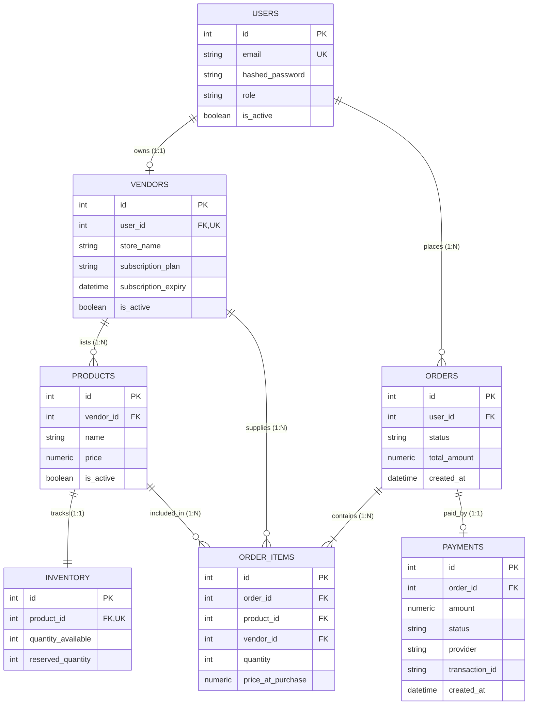
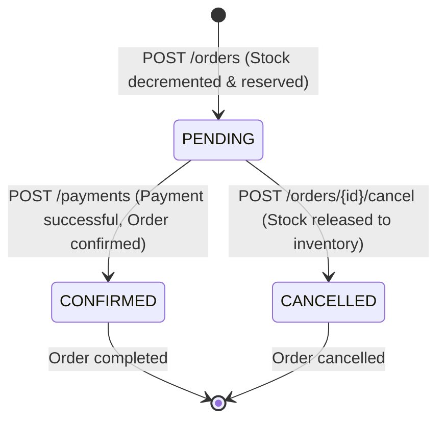

# Mizigo Marketplace Architecture

## 1. Overview & Technology Stack

Mizigo is a near-production multi-vendor marketplace designed with a clean, accessible technology stack:

- **Backend**: Python 3.10+, FastAPI, SQLAlchemy 2.0, Pydantic v2, PostgreSQL, Alembic
- **Security**: OAuth2 Bearer JWT (`python-jose`), bcrypt password hashing (`passlib`)
- **Frontend**: React 18, Vite, Tailwind CSS, React Router v6, native browser `fetch`
- **Testing**: Pytest, Starlette `TestClient`, isolated SQLite in-memory engine
- **Infrastructure**: Docker, Docker Compose, GitHub Actions CI

---

## 2. Request Lifecycle & Layered Responsibilities

```
[ Client Request ]
       │
       ▼
[ FastAPI App & Middlewares ]
 ├── CORS Middleware (Configurable Origins)
 ├── Rate Limiting (SlowAPI)
 └── Exception Handlers (Consistent JSON error responses)
       │
       ▼
[ Routers (HTTP & Routing Layer) ]
 ├── Dependency Injection (get_db, get_current_user, require_admin_user, require_active_vendor)
 └── Pydantic Schema Validation (Request validation & Response serialization)
       │
       ▼
[ Services (Business Logic & Transactions) ]
 ├── Product Service (Subscription plan limits, active state verification)
 ├── Order Service (Deterministic sorted locking, inventory checks, price calculation)
 └── Payment Service (Atomic state transitions, idempotency, unique transaction generation)
       │
       ▼
[ SQLAlchemy ORM & PostgreSQL Database ]
```

### Layer Responsibilities
1. **Routers (`app/routers/`)**: Handle HTTP requests, status codes, query/path parameters, and authorization dependencies.
2. **Schemas (`app/schemas/`)**: Pydantic models for request payload validation and response contracts.
3. **Services (`app/services/`)**: Enforce business rules, coordinate multi-model updates, and manage transaction commit/rollback boundaries.
4. **Models (`app/models/`)**: Declarative SQLAlchemy models defining schema, column constraints, and foreign key relationships.

---

## 3. Database Entity Relationships



---

## 4. Order & Payment Lifecycle



### Key Business Rules:
1. **Server-Authoritative Pricing**: Customers submit only `product_id` and `quantity`. Total prices are derived strictly from the database.
2. **Inventory Concurrency Protection**: Orders acquire row locks using `SELECT ... FOR UPDATE` ordered by `product_id` to prevent deadlocks and race conditions.
3. **Pending Reservation**: Stock is decremented upon order creation. If unpaid, orders can be cancelled via `POST /orders/{id}/cancel`, which returns items back to available inventory.
4. **Idempotent Payment**: Once an order is `CONFIRMED`, duplicate payment requests are rejected. Cancelled orders cannot be paid.
